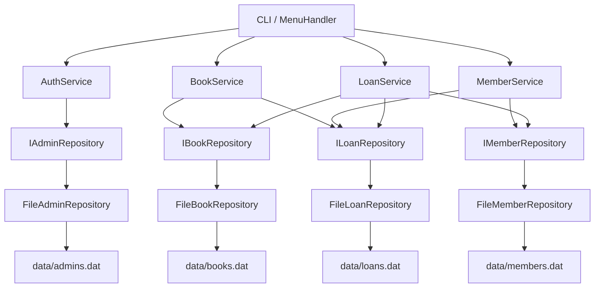

# Smart Library Management System

> A complete, professional **C++17** console application for managing a library — books, members, loans, fines, and reports — built as an academic portfolio project suitable for Software Engineering placement interviews.

---

## Overview

The Smart Library Management System is a menu-driven console application that handles the full lifecycle of a library: cataloguing books, registering members, issuing and returning books, calculating overdue fines, and generating reports.

**Primary goal:** Demonstrate clean object-oriented C++17 design — encapsulation, abstraction, polymorphism, RAII, dependency injection — backed by persistent file storage with an optional MySQL integration path.

---

## Problem Statement

Manual library management is error-prone: lost records, incorrect inventory counts, missed fine calculations, and no audit trail. This system automates all core library operations with data validation, business-rule enforcement, and persistent storage.

---

## Features

- ✅ **Admin authentication** — SHA-256 password hashing (CommonCrypto), first-run setup flow
- ✅ **Book catalogue** — Add, list, search (title/author/ISBN/category), update, deactivate
- ✅ **Member management** — Register, list, search, update, deactivate; email uniqueness enforced
- ✅ **Issue books** — Validates book/member status, availability, max-loan limits
- ✅ **Return books** — Closes loan, calculates overdue fine, restores inventory atomically
- ✅ **Fine calculation** — Configurable rate (default ₹5/day), displayed in INR
- ✅ **Search & Reports** — Available books, active loans, overdue loans, member history, most-issued books, inventory summary
- ✅ **File-backed persistence** — Pipe-delimited flat files, survives restart; no server required
- ✅ **MySQL integration** — Full SQL schema + stored procedures ready; enabled when connector is installed
- ✅ **Configuration** — `.env` file or environment variables for all tuneable settings
- ✅ **Input validation** — All cin reads guarded; bad input never crashes the app
- ✅ **42 unit tests** — All passing; covers every major business rule
- ✅ **No third-party test framework** — Self-contained test runner

---

## Technology Stack

| Component | Technology |
|-----------|-----------|
| Language | C++17 |
| Build System | CMake 3.16+ |
| Compiler tested | Apple Clang 21 / GCC 12+ |
| Password hashing | SHA-256 via CommonCrypto (macOS built-in) |
| Default storage | Pipe-delimited flat files (`data/`) |
| Optional DB | MySQL 8.x + MySQL Connector/C++ |
| Test framework | Self-contained (no Catch2/GTest needed) |

---

## Architecture



**Layered architecture:**
```
Presentation (CLI)  →  Service Layer (business rules)  →  Repository Interfaces  →  File / MySQL Implementations
```

---

## Folder Structure

```
Smart Library Management System/
├── CMakeLists.txt
├── .env.example
├── .gitignore
├── README.md
├── database/
│   ├── schema.sql          # MySQL schema
│   ├── seed.sql            # Demo data
│   └── setup_guide.md      # MySQL setup instructions
├── docs/
│   ├── INTERVIEW_PREPARATION.md
│   └── PROJECT_DEMO_SCRIPT.md
├── src/
│   ├── main.cpp
│   ├── cli/
│   │   ├── MenuHandler.h
│   │   └── MenuHandler.cpp
│   ├── models/
│   │   ├── Book.h
│   │   ├── Member.h
│   │   ├── Loan.h
│   │   └── Admin.h
│   ├── repositories/
│   │   ├── IBookRepository.h
│   │   ├── IMemberRepository.h
│   │   ├── ILoanRepository.h
│   │   ├── IAdminRepository.h
│   │   ├── FileBookRepository.h / .cpp
│   │   ├── FileMemberRepository.h / .cpp
│   │   ├── FileLoanRepository.h / .cpp
│   │   └── FileAdminRepository.h / .cpp
│   ├── services/
│   │   ├── AuthService.h / .cpp
│   │   ├── BookService.h / .cpp
│   │   ├── MemberService.h / .cpp
│   │   └── LoanService.h / .cpp
│   └── utils/
│       ├── Config.h / .cpp
│       ├── DateUtils.h / .cpp
│       ├── InputValidator.h / .cpp
│       └── PasswordUtils.h / .cpp
└── tests/
    └── test_main.cpp       # 42 self-contained unit tests
```

---

## Prerequisites

| Requirement | Version | Notes |
|-------------|---------|-------|
| C++ compiler | Clang 12+ / GCC 10+ | C++17 support required |
| CMake | 3.16+ | |
| MySQL | 8.x | Optional — for MySQL storage mode |
| MySQL Connector/C++ | 8.x | Optional — detected automatically by CMake |

---

## Installation & Build

### macOS / Linux

```bash
# 1. Clone or open the project folder
cd "Smart Library Management System"

# 2. Configure
mkdir build && cd build
cmake ..

# 3. Build everything
make -j8

# 4. Run the application
./library_app

# 5. Run tests
./library_tests
```

### Windows (MSVC / MinGW)

```bat
mkdir build
cd build
cmake .. -G "Visual Studio 17 2022"
cmake --build . --config Release
Release\library_app.exe
```

> On Windows, replace `CommonCrypto` with WinCrypt or compile-in a SHA-256 implementation; see `src/utils/PasswordUtils.cpp` for the platform guard.

---

## Configuration

Copy `.env.example` to `.env` and edit as needed:

```bash
cp .env.example .env
```

```ini
# Storage mode: "file" (default) or "mysql"
STORAGE_MODE=file

# Loan settings
LOAN_PERIOD_DAYS=14
FINE_RATE_PER_DAY=5
MAX_ACTIVE_LOANS=3

# MySQL (only needed when STORAGE_MODE=mysql)
DB_HOST=localhost
DB_PORT=3306
DB_NAME=library_management
DB_USER=library_user
DB_PASSWORD=your_password_here
```

Environment variables override `.env` values.

---

## Database Setup (Optional MySQL)

See [`database/setup_guide.md`](database/setup_guide.md) for full instructions.

Quick start:
```bash
mysql -u root -p < database/schema.sql
mysql -u root -p < database/seed.sql
```

Then set `STORAGE_MODE=mysql` in your `.env`.

---

## Sample Menu Walkthrough

```
========================================
   Smart Library Management System
========================================
Storage mode: file

[First run] No admin account found.
=== Create Admin Account ===
Username: admin
Password: ••••••••
Confirm password: ••••••••
✓ Admin account created.

Login
Username: admin
Password: ••••••••
✓ Login successful.

===== Main Menu =====
1. Book Management
2. Member Management
3. Issue Book
4. Return Book
5. Search & Reports
6. Exit
Choice: 1

===== Book Management =====
1. Add Book  2. List All Books  3. Search Books
4. Update Book  5. Deactivate Book  6. Back
Choice: 1

Title: Clean Code
Author: Robert C. Martin
ISBN (leave blank to skip): 9780132350884
Category: Technology
Publication year (0 to skip): 2008
Number of copies: 3
✓ Book added (ID: 1).
```

---

## Running Tests

```bash
cd build
./library_tests
```

Expected output:
```
===== Smart Library Management System — Unit Tests =====

--- DateUtils Tests ---
  [PASS] test_parseDate_valid
  ...
--- LoanService Tests ---
  [PASS] test_fine_calculated_when_late
  ...
========================================
Results: 42/42 passed
========================================
```

---

## Known Limitations

- **File storage is not thread-safe** — designed for single-user console use
- **MySQL Connector/C++ not bundled** — MySQL repositories compile only when the connector is installed; file mode is the default
- **No GUI** — Console only by design (academic portfolio scope)
- **No reservation/waitlist** — Future enhancement
- **Windows SHA-256** — PasswordUtils uses CommonCrypto (macOS). A `#ifdef _WIN32` branch with WinCrypt is needed for Windows builds

---

## Future Enhancements

- Reservation / waitlist queue
- Email notifications for overdue books
- Barcode / QR scanning integration
- Web API (REST) layer
- Role-based access (admin vs. librarian vs. reader)
- Multi-branch support
- Automated fine waivers and payment tracking
